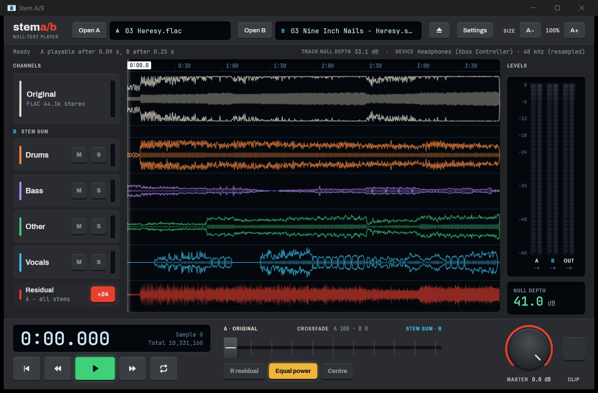

# Stem A/B Player

A critical-listening tool for judging **stem-separation quality** on Windows. Load an original track (**A**)
and its separated stems (**B**), and the player lines them up sample-accurately, plays them back with one
crossfade between A and B, and tells you — by ear and by number — how well the stems add back up to the
original.



## What it does

- **A/B comparison on one timeline.** B (the sum of the four stems) is aligned to A automatically by
  cross-correlation, so you hear the same moment when you switch. The Crossfade blends A ↔ B; **R** plays the
  Residual (A − all stems), which is silence when the separation is perfect.
- **Null depth, measured.** *Track Null Depth* (whole track, computed on load) and *Live Null Depth* (around
  the playhead) say in dB how far the Residual sits below A. Higher is better.
- **Fidelity first.** Nothing in the listening path treats A and B differently: no limiter, no
  level-matching. One Master Gain applies to everything; clipping is shown, never hidden.
- **DJ-style waveforms.** One lane for A, one per stem, one for the Residual (viewable at +24 dB), with a
  shared playhead you can click or drag to seek while playing.
- **Mute / Solo per stem**, fine L/R LED meters with peak hold, and a loop.
- **Two kinds of B:** an NI/Traktor **Stem File** (`.stem.m4a`), or a **Stem Set** of 1–4 separate audio
  files (e.g. `drums.wav`, `bass.wav`, `other.wav`, `vocals.wav` from Demucs or UVR).
- **Fast.** Files decode in parallel the moment you pick them (a waveform preview appears before the pair is
  complete); alignment takes milliseconds and is cached.
- **Resumes where you left off**, with your device, mix settings and playhead position.
- **Color-blind safe palette** (red–green) in Preferences, and interface sizes from 90 % to 130 %.

## Quick start

1. **Open A** — pick the original track (FLAC, WAV, AIFF, MP3, AAC/M4A, ALAC, Ogg, Opus, WMA, APE, WavPack,
   DSD, …).
2. **Open B** — pick a `.stem.m4a`, *or* select 1–4 stem files at once (Ctrl/Shift-click).
3. Press **Space** to play. **A**, **B** and **C** jump the Crossfade to all-A, all-B and center; **R**
   toggles the Residual.

The full guide is in [docs/USER-GUIDE.md](docs/USER-GUIDE.md).

## Keyboard shortcuts

| Key | Action |
|---|---|
| Space | Play / pause |
| ← / → | Seek 1 s (Shift: 5 s) |
| Home | Back to the start |
| A / B / C | Crossfade to A, to B, to center |
| R | Residual on / off |
| L | Loop on / off |
| 1–4 | Solo Drums, Bass, Other, Vocals |
| Shift+1–4 | Mute Drums, Bass, Other, Vocals |
| Ctrl+= / Ctrl+− / Ctrl+0 | Larger / smaller / default interface size |
| Ctrl+, | Preferences |

## System requirements

- Windows 10 or 11, 64-bit
- Any WASAPI output device; ASIO drivers are supported when the app is built with the Steinberg ASIO SDK
- RAM: decoded audio is held in memory — roughly 50 MB per minute for A plus the stems

## Installing a release build

A release is a folder with `Stem AB Player.exe` and the three FFmpeg DLLs next to it (`avcodec-*.dll`,
`avformat-*.dll`, `avutil-*.dll`). Unzip it anywhere and run the exe; there is no installer. Settings live in
`%APPDATA%\StemABPlayer\` (see the user guide).

## Building from source

See [BUILDING.md](BUILDING.md) — Visual Studio 2022, CMake presets, vcpkg (FFmpeg) and JUCE. In short:

```powershell
cmake --preset vs2022
cmake --build --preset release
ctest --preset release
```

## Documentation

| Document | What's in it |
|---|---|
| [docs/USER-GUIDE.md](docs/USER-GUIDE.md) | How to use every part of the app |
| [BUILDING.md](BUILDING.md) | Building, testing and packaging a release |
| [docs/BUILDING-ASIO.md](docs/BUILDING-ASIO.md) | Building with ASIO support (Steinberg SDK) |
| [CHANGELOG.md](CHANGELOG.md) | What changed in each version |
| [CONTEXT.md](CONTEXT.md) | Glossary of the terms used in the app and the code |
| [docs/adr/](docs/adr/) | Architecture decision records |
| [THIRD-PARTY-NOTICES.md](THIRD-PARTY-NOTICES.md) | Licenses of the libraries and fonts used |

## License

Stem A/B Player is licensed under the **GNU Affero General Public License v3.0** — see [LICENSE](LICENSE).
The libraries and fonts it uses have their own licenses, listed in
[THIRD-PARTY-NOTICES.md](THIRD-PARTY-NOTICES.md). ASIO support uses the Steinberg ASIO SDK under its GPLv3
option, which is compatible with this project's AGPL-3.0.

## Project layout

```
src/decode     FFmpeg decoding of Originals, Stem Files and Stem Sets
src/analysis   Alignment (cross-correlation), Null Depth, waveform summaries
src/load       Pair loading, decode stash, alignment cache
src/engine     Real-time playback engine, crossfade, resampler, live null depth
src/app        JUCE application: main window, Preferences, settings, theme
tests          Catch2 unit tests
tools          StemAB_Probe (headless analysis / stem export), icon generator
resources      Bundled fonts and the app icon
```
