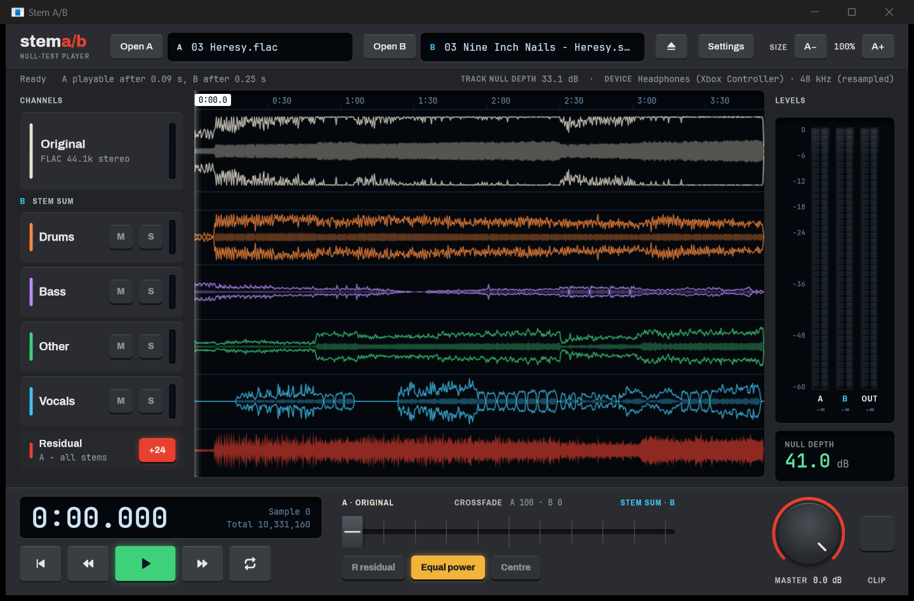
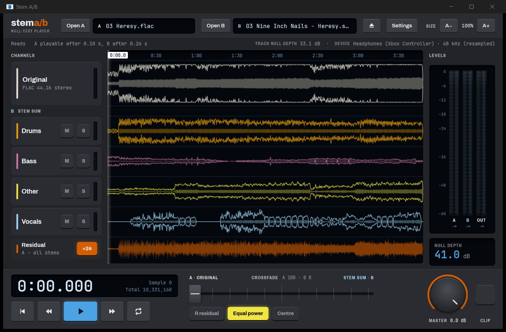

# Stem A/B Player — User Guide

Stem A/B Player answers one question: **do the separated stems add back up to the original?** You load the
original track as **A** and its four stems as **B**; the app aligns them, lets you switch and blend between
them while listening, and measures what is left over when B is subtracted from A.



---

## 1. Loading files

### A — the Original

Click **Open A** (left of the A file box) and pick the unseparated track. Any format FFmpeg reads works:
FLAC, WAV, AIFF/AIFC, MP3, AAC/M4A/MP4, ALAC, Ogg Vorbis, Opus, WMA, APE, WavPack, TTA, DSD (DSF/DFF), CAF,
W64/RF64. Mono files are played as stereo; files with more than two channels are refused.

### B — the stems

Click **Open B** and choose **one** of:

- **A Stem File** — a single NI/Traktor `.stem.m4a` (also recognised: an `.m4a`/`.mp4` that contains five
  audio streams). It holds an embedded master (ignored — A is always your own original) plus the four stems.
- **A Stem Set** — 1 to 4 separate audio files selected together (Ctrl-click or Shift-click, or Ctrl+A in a
  folder). Typical sources: Demucs (`drums.wav`, `bass.wav`, `other.wav`, `vocals.wav`) or UVR
  (`Song_(Vocals).wav`, `Song_(Instrumental).wav`).

**How Stem Set files are matched to stems** (case-insensitive, whole words in the file name):

| Stem | Keywords |
|---|---|
| Drums | drums, drum, kick(s), perc(s), percussion |
| Bass | bass, bassline |
| Vocals | vocals, vocal, vox, voice(s), acapella |
| Other | other(s), instrumental(s), inst, accomp, accompaniment, music, melody, karaoke — and "no vocals", "without drums", `novocals` etc. (a 2-stem separator's "everything else") |

If a name contains several keywords, the last one wins (`The Other Side (Vocals).wav` → Vocals). Files with no
keyword fill the free slots, Other first. Selecting more than four files, the same file twice, or two files
for the same stem shows an error and nothing loads.

Rules for a Stem Set:

- All files must have the **same sample rate** (nothing is resampled between stems).
- Mono files are played as stereo; shorter files are padded with silence to the longest.
- **Missing stems are silent.** Their lanes say *No file* and their M/S buttons are disabled. The Residual is
  then A minus the stems you provided.

The B file box shows a short label for the set; hover it to see which file went to which stem.

### Previews and loading

As soon as you pick *one* file its waveform appears (a preview), even before the other side is chosen. When
both are chosen the pair loads: A becomes playable first, then the stems are aligned. The status line under
the header shows progress, and the decoded preview is reused, so nothing is decoded twice.

### Unload all

The eject button in the header stops playback, clears both files and forgets the saved session (mix settings
such as the crossfade are kept).

---

## 2. Listening

| Control | What it does |
|---|---|
| **Play** (Space) | Play / pause. Pause fades out and keeps the playhead where it is. |
| **To start / Back / Forward** | Home, and seek −/+1 s (Shift: 5 s) with the arrow keys. |
| **Loop** (L) | Repeats the whole track. |
| **Crossfade** | Blends from all A (left) to all B (right). A / B / C jump to A, B and center; double-click the fader to center it. |
| **Equal power** | Crossfade curve: equal-power (on) or linear (off). |
| **R residual** (R) | Plays the Residual, A − all four stems. Silence = perfect reconstruction. |
| **Center** | Crossfade to A 50 / B 50. |
| **Master** knob | One gain for everything heard, at most 0 dB. Double-click resets to 0 dB. |
| **Clip** | Lights when the output exceeds 0 dBFS. Click to reset; lower Master to fix it. |

**Seeking:** click or drag in any waveform lane, while playing or paused.

### Mute and Solo

Each stem has **M** (mute) and **S** (solo) pads; keys **1–4** solo and **Shift+1–4** mute Drums, Bass,
Other, Vocals. If any stem is soloed you hear only the soloed stems; otherwise you hear the un-muted ones.
Mute/Solo only change what you *hear* in B — they never change the Residual or the null-depth numbers.

---

## 3. Reading the display

### Waveform lanes

- **A · Original** on top, then the four stems, then the **Residual**.
- Each lane shows the peak outline with the RMS body inside it, in the stem's color.
- The **Residual** is drawn amplified **+24 dB** by default so you can see it; the **+24** pad toggles it to
  its true level (0 dB). This is display only — what you hear is never changed.
- The white line is the playhead; its tag shows the time.

### Levels

- **A**, **B** and **OUT** meters, each left/right, 40 segments of 1.5 dB from −60 to 0 dBFS.
- Green → amber → red as the level rises; the single lit segment above the bar is the **peak hold** (held
  0.5 s, then falls).
- Each stem strip also has a small meter.

### Null depth

- **Null Depth** (under the meters) is the *live* value around the playhead.
- **Track Null Depth** in the status line is the whole-track value, measured when the pair loads.
- Both are "how far below A the Residual sits", in dB. Higher is better; 30–40 dB is typical for good
  separations of lossy stems.

### Status line

Under the header: load progress and any warning on the left; the alignment offset (in samples, with its
confidence ρ), Track Null Depth, the audio device and sample rate on the right. When the window is narrow the
less important groups are hidden.

### Time display

Large time (m:ss.mmm), with the current **Sample** and the **Total** length in samples beside it.

---

## 4. Preferences (Settings, Ctrl+,)

| Section | Settings |
|---|---|
| **Folders** | Where the Open A / Open B dialogs start (you can still browse anywhere), or remember the last folder used. |
| **Interface** | Interface size (90 / 100 / 115 / 130 %, same as A− / A+); **Color palette**: Standard or Color-blind safe (red–green). |
| **Audio** | Output device type (WASAPI, ASIO if built in), device, sample rate, buffer size. |
| **Session** | Reopen the last pair on launch, paused where you left it, with the same mix settings. |

The **Color-blind safe** palette swaps every red/green pair (meters, Play, Mute, the Residual and the stem
colors) for blue / yellow / vermillion hues that stay distinct with protanopia and deuteranopia. It applies
immediately.



### Sample rate and resampling

If the output device accepts the files' own sample rate, playback runs at that rate (*Native Rate*).
Otherwise the mixed output is resampled to the device rate in real time, shown as *(resampled)* in the
status line. Everything goes through the same resampler, so A and B are still treated identically. Exclusive
mode or ASIO usually allows the native rate.

---

## 5. Files the app keeps

| File | Purpose |
|---|---|
| `%APPDATA%\StemABPlayer\settings.xml` | Preferences, window position, last session |
| `%APPDATA%\StemABPlayer\alignment-cache.json` | Cached alignment offsets, so a pair you have opened before loads instantly |

Deleting either is safe; the app recreates them with defaults.

---

## 6. Troubleshooting

| Symptom | What to do |
|---|---|
| **Clip** lights | Lower **Master**. The app never limits or compresses, by design. |
| "No audio device open" | Choose a device in Preferences → Audio. |
| Stem Set refuses to load | Check the error in the status line: mismatched sample rates, more than 4 files, or two files mapped to the same stem. Rename files so their names contain the stem keyword. |
| Alignment confidence is low | The tracks may not be the same master, or B is heavily processed; listen to the Residual to judge. |
| Window too small, lanes scroll | Use A− (Ctrl+−) for a smaller interface size, or enlarge the window. |

---

## 7. Making test Stem Sets

The bundled command-line tool `StemAB_Probe` can export a Stem File's stems as separate WAVs:

```
StemAB_Probe --export-stems "<file.stem.m4a>" "<output folder>" [16|24|32]
```

It writes `drums.wav`, `bass.wav`, `other.wav` and `vocals.wav` (24-bit by default). Given an original and a
stem file instead, it prints their alignment and null depth: `StemAB_Probe "<original>" "<stem file>"`.
`StemAB_Probe.exe` is built next to the tests, in `build\vs2022\tools\StemAB_Probe\Release\`.
